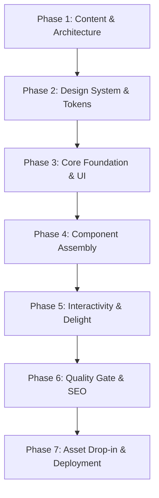

# Portfolio Webpage: Strategic Design & Implementation Plan

A comprehensive roadmap and tracking document for a client-facing developer portfolio bridging institutional registrar/systems engineering at **UPLB College of Forestry & Natural Resources (Office of the College Secretary)** with independent commercial client work.

---

## 1. Context & Positioning Strategy

### Profile Matrix
- **Primary Role**: Systems Developer, **Office of the College Secretary (OCS)** — UPLB College of Forestry and Natural Resources (CFNR).
  - *Core strengths*: High-stakes academic administrative operations, document tracking, cryptographic QR verification, graduation audits, prerequisite waivers, and student records integrity.
- **Secondary Role / Side Hustle**: Independent Freelance & Commercial Product Builder.
  - *Core strengths*: Rapid delivery, modern tech stacks, custom UX/UI, commercial web apps, business automation.

### The Positioning Strategy
Position as an **"Institutional Administrative Systems Engineer & Commercial Product Builder"**. Highlight that clients get the rigorous data integrity, reliability, and security of university registrar operations combined with the speed and modern UI craft of an agile product shop.

---

## 2. Theme & Aesthetic Concepts

### Selected Theme: "Botanical Field Journal & Mt. Makiling Heritage" (Implemented)
- **Primary / Default Mode**: Clean White / Light Mode (`#f7faf7` background, `#ffffff` card surfaces, deep pine-charcoal `#0a2014` text with >14:1 contrast).
- **Secondary / Toggle Mode**: Dark Makiling Night (`#060e0a` background, `#0c1811` surfaces, `#f0fdf4` text).
- **Institutional Forest Accents**: Lush Canopy Emerald (`#047857` / `#10b981`), Molave Timber Bark & Amber (`#92400e` / `#b45309`).
- **Commercial Accents**: Electric Ocean Blue / Cyan (`#0284c7` / `#06b6d4`).
- **Delight & Interactivity**:
  - Interactive "Canopy Mode" floating leaf physics canvas.
  - One-click Sun/Moon theme switcher persisting to `localStorage`.
  - Mt. Makiling Coordinates badge: `14.1378° N, 121.1989° E`.

---

## 3. Recommended Design Agents & AI Tools

| Agent / Tool | Best Used For | Current Status |
| :--- | :--- | :--- |
| **`impeccable` Skill (In-IDE Agent)** | Design system generation, visual polish, layout audit, color harmony, accessibility checks | **Utilized**: Enforced craft-floor rules (no gradient text, no kickers, themed browser surfaces, WCAG AAA contrast). |
| **v0 by Vercel / Lovable** | Exploratory component prototyping and layout brainstorming | **Reference**: Can be used for future standalone page prototypes. |
| **Figma AI / Relume** | Information architecture and sitemap generation | **Completed**: Core architecture established in codebase. |

---

## 4. Information Architecture & Page Structure

```text
1. Site Header
   ├── Brand Monogram (UPLB CFNR OCS & Commercial Systems)
   ├── Main Navigation (Selected Systems, Architecture, Services, Office Background)
   ├── Theme Toggle (Light / Dark)
   └── Canopy Delight Mode (Floating Makiling Leaves Animation)

2. Hero Section
   ├── OCS Institutional & Mt. Makiling Heritage Pill
   ├── Value proposition headline & description
   ├── Primary CTAs ("View Case Studies", "Start a Project Inquiry")
   └── Proof Metrics Strip (10,000+ Documents Tracked, 100% Curricular Audit Accuracy, 14+ Commercial Projects)

3. Interactive Work Showcase (Bifurcated View)
   ├── Track 1: UPLB CFNR OCS Systems (Document Tracker, Graduation Audit, Prerequisite Waivers)
   ├── Track 2: Commercial Client Projects (Supply Chain Ops, Booking SaaS, Restaurant POS)
   ├── Dynamic Project Preview Containers (GIF / Screenshot drop-in ready)
   └── Deep-Dive Architectural Dossier Modals (Problem -> Solution -> Verified Outcome)

4. Client FAQ & Visual Proof Guidance
   ├── Advice on animated GIFs vs. static screenshots
   └── Why confidential institutional repositories are presented via case studies

5. Architectural Standards Matrix
   ├── Document Routing & Auditing
   ├── Access Control & Data Security
   ├── High-Integrity Databases (ACID, connection pooling)
   └── Modern Web & API Architecture

6. Client Engagement Offerings
   ├── Custom Web Applications & Portals
   ├── Internal Automation & Data Workflows
   └── System Audits & Architecture Modernization

7. Office Background & Heritage
   ├── Narrative bridging UPLB OCS administrative discipline with commercial agility
   └── Credential indicators

8. Contact & Project Inquiry
   ├── Direct contact card (One-click email copy with toast feedback, LinkedIn, GitHub)
   └── Interactive project inquiry form with client-side validation
```

---

## 5. Step-by-Step Implementation Roadmap & Status



### Phase 1: Content & Asset Curation
- [x] Select 3 flagship university systems from the Office of the College Secretary:
  - *OCS Academic Document Tracking & Verification Platform* (`ocs-document-tracker`)
  - *Student Curricular Evaluation & Clearance Engine* (`graduation-audit`)
  - *Course Prerequisite Waiver & Enrollment Endorsement Core* (`prerequisite-waiver`)
- [x] Select 3 commercial/client projects with outcomes:
  - *Atlas Trucking & Multi-Hub Freight Operations Platform* (`atlas-trucking` — 1,222 commits, Next.js 16 monorepo)
  - *High-Converting Client Booking & Intake Platform* (`saas-scheduler`)
  - *Cloud POS & Real-Time Kitchen Display System* (`retail-pos`)
- [x] Integrate real Atlas Trucking platform screenshots (`assets/screenshots/atlas/screenshots/08_admin_dashboard.png`).
- [ ] Drop remaining screenshots for OCS systems into `assets/screenshots/`.

### Phase 2: Design System & Visual Specification
- [x] Define color palette tokens (Light Botanical Field default + Dark Makiling Night).
- [x] Set up UPLB Forestry Emerald (`#047857`) and Molave Timber Bark (`#92400e`).
- [x] Define typography pairings (`Outfit` for headings, `Inter` for body, `JetBrains Mono` for tech tags).
- [x] Codify craft floor rules in `DESIGN.md` (no kickers, no text gradients, themed browser surfaces).

### Phase 3: Core Foundation Setup
- [x] Create semantic `index.html` structure.
- [x] Build modular `style.css` using CSS custom properties with responsive container system.
- [x] Implement browser surface theming (`::selection`, custom scrollbar, `:focus-visible` rings).

### Phase 4: Component & Section Assembly
- [x] Hero section with UPLB CFNR OCS positioning and metrics strip.
- [x] Filterable project gallery with category counts (All, UPLB OCS, Commercial).
- [x] Dynamic media preview containers with fallback drop-in hints.
- [x] Architectural standards matrix and service offering cards.
- [x] Contact section with copyable email card and validated inquiry form.

### Phase 5: Interactivity & Polish
- [x] Implement category filtering logic in `script.js` with active state tracking.
- [x] Build interactive architectural deep-dive modal with keyboard escape & focus trapping.
- [x] Implement theme switcher (Light by default, Dark mode toggle, saved to `localStorage`).
- [x] Implement interactive "Canopy Mode" floating foliage canvas animation.
- [x] Add copy-to-clipboard email button with temporary feedback toast.
- [x] Responsive navigation drawer for mobile screens.

### Phase 6: Verification & SEO Readiness
- [x] Audit WCAG accessibility (contrast ratios > 14:1 in light mode, clean semantic labels).
- [x] Configure Open Graph (OG) meta tags for rich social and chat link previews (WhatsApp, LinkedIn).
- [x] Mobile viewport test structure (touch targets > 44px, single-column flex grids).

### Phase 7: Final Delivery & Deployment (Ready for User Action)
- [ ] Capture static screenshots of your actual projects and drop them into `assets/screenshots/`.
- [ ] Update contact links in `index.html` (your actual email, LinkedIn URL, GitHub profile).
- [ ] Deploy to hosting of choice (GitHub Pages, Vercel, Cloudflare Pages, or Netlify).
