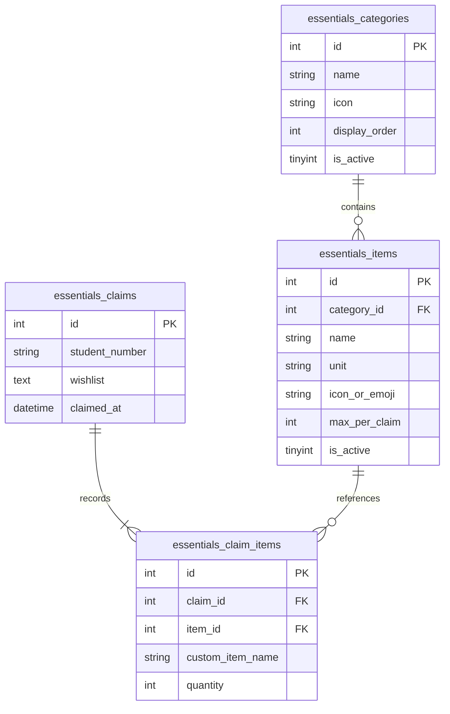

# 🥫 Essentials Hub (Student Welfare Pantry)
### Office of the College Secretary (OCS)
### College of Forestry and Natural Resources (CFNR) — University of the Philippines Los Baños

---

> **📅 Feature Timeline & Launch Milestones**
> - **Initial Feature Push to GitHub**: `September 14, 2026` *(Commit `d821441`: Add Essentials Hub kiosk interface and admin management)*
> - **Welfare Analytics Dashboard Added**: `September 18, 2026` *(Commit `ac7cfe0`: Add Essentials Hub statistics dashboard and update navigation)*
> - **Beneficiary Intelligence & Hardening**: `October 22, 2026` *(Commit `838c5a2`: Add last visited beneficiary metrics and resolve checklist security and logic bugs)*

---

## 📖 Overview

The **Essentials Hub** is an integrated student welfare pantry service embedded within the DTOCS-CFNR platform. Designed specifically for the forestry and natural resources student body, it enables enrolled students to conveniently request, claim, and receive essential supplies—such as field gear, uniforms, personal protective equipment, academic materials, and personal welfare necessities.

The module operates across three distinct operational layers:
1. **Self-Service Kiosk (`data_essentials.php`)**: Fast, touchscreen-friendly claim portal for students.
2. **Administration & Inventory Hub (`essentials_admin.php` & `essentials_log.php`)**: Full inventory, category, and historical claim management for OCS staff and administrators.
3. **Analytics & Welfare Intelligence (`essentials_statistics.php`)**: Deep analytics on student claim trends, most-needed items, beneficiary cohorts, and student wishlists.

---

## 📁 Architecture & File Structure

```plaintext
components/
├── log_book/
│   ├── data_essentials.php          # Student-facing kiosk interface
│   ├── data_essentials.js           # Kiosk interaction, cart logic & timers
│   ├── data_essentials.css          # Kiosk touch styling & responsive layouts
│   ├── essentials_admin.php         # Inventory manager (categories, items, stock)
│   ├── essentials_log.php           # Historical claims log & exportable records
│   └── query_essentials.php         # Core backend API (CRUD, claims, validation)
└── statistics/
    ├── essentials_statistics.php    # Dedicated analytics dashboard
    ├── query_essentials_stats.php   # Aggregated analytics query processor
    └── essentials_style.css         # Analytics theme styling & KPI card metrics
```

---

## 🛒 1. Student Kiosk Interface (`data_essentials.php`)

Located under **Kiosk Mode &rarr; Essentials Hub**.

### Key Capabilities
- **Student Authentication & Validation**:
  - Requires 9-digit Student Number lookup.
  - Live query to CSAR database auto-populates student full name.
  - Enforces per-student daily claim limits to ensure equitable distribution.
- **Visual Category Filter Pills**:
  - Filter items rapidly by category (e.g. *Uniforms & Attire*, *Fieldwork & Forestry Tools*, *Academic Supplies*, *Safety Gear*).
- **Interactive Item Cards**:
  - Displays item name, unit, visual emoji/icon, and remaining claim allowance.
  - Interactive increment/decrement controls with automatic maximum limit bounds.
- **Brand-Free / Generic Nomenclature**:
  - All items adhere strictly to generic names to maintain official institutional compliance.
- **Wishlist & Suggestion Collector**:
  - Students can type custom wishlists or needed items before submitting their claim.
- **Self-Dismissing Auto-Reset**:
  - Once a claim is submitted, a confirmation modal presents a 5-second countdown timer before automatically clearing student session data, sanitizing inputs, and resetting the screen for the next student in queue.

---

## ⚙️ 2. Inventory Management (`essentials_admin.php`)

Located in the administrative navigation under **Panel &rarr; Essentials Inventory**.

### Key Capabilities
- **Item Catalog Management**:
  - Add new items, update descriptions, assign categories, and modify maximum claim limits per transaction.
- **Interactive Modals**:
  - Dual-column responsive modal (780px) equipped with quick-select unit pills (`pc`, `pack`, `set`, `kit`, `pair`) and visual icon selectors.
- **Safe Item Deactivation**:
  - Items with existing transaction history cannot be permanently deleted from the database. Instead, they are gracefully deactivated (`is_active = 0`), preserving audit trails and historical reporting integrity.
- **Category Control**:
  - Add and reorder categories with custom display priority and FontAwesome icons.

---

## 📋 3. Claims & Audit Log (`essentials_log.php`)

Located under **Management &rarr; Essentials Hub Log**.

### Key Capabilities
- **Detailed Claim Logs**:
  - Student number, full name, timestamp, summarized item breakdowns, and recorded quantities.
- **Filter & Search**:
  - Filterable by date ranges, student number, or item type.
- **Student Feedback Review**:
  - Direct visibility into student-submitted wishlists and requested items for future procurement.
- **Quick Navigation**:
  - One-click shortcuts to the inventory manager and statistics analytics board.

---

## 📊 4. Welfare Analytics & Statistics (`essentials_statistics.php`)

Located under **Statistics &rarr; Essentials Hub Statistics**.

### Key Metrics & Visualizations
- **4 Hero KPI Summary Cards**:
  1. **Total Claims**: All-time claim count vs. today's live activity pill.
  2. **Unique Beneficiaries**: Distinct student count served.
  3. **Total Items Distributed**: Aggregate item volume released.
  4. **Top Claimed Item**: Highest-demand item with total quantity badge.
- **Top Claimed Items Ranking**:
  - Side-by-side rankings of all-time highest-demand items vs. today's most-claimed items.
- **Frequent Beneficiaries Table**:
  - Identifies students utilizing the service most frequently, tracking total visits and last visit date.
- **Unlisted Items & Wishlist Intelligence**:
  - Tracks custom unlisted items claimed and student wishlist suggestions to inform upcoming replenishment and supply drives.

---

## 🗄️ Database Schema

The Essentials Hub utilizes 4 core relational tables:



---

## 🔌 API Reference (`query_essentials.php`)

| Action (`?action=`) | Method | Description |
|---|---|---|
| `get_items` | `GET` | Fetches active categories with active items for the student kiosk. |
| `lookup_student` | `GET` | Verifies student number against the student database. |
| `submit_claim` | `POST` | Records a new claim transaction and its claimed items. |
| `get_claims_log` | `GET` | Retrieves paginated and filtered historical claims data. |
| `get_admin_items` | `GET` | Returns full inventory catalog for the admin panel. |
| `get_categories` | `GET` | Lists all active categories. |
| `add_item` | `POST` | Creates a new inventory item. |
| `update_item` | `POST` | Updates existing item properties. |
| `toggle_item_status` | `POST` | Activates or deactivates an item. |
| `delete_item` | `POST` | Safely deactivates or removes an unused item. |
| `get_summary_cards` *(via `query_essentials_stats.php`)* | `GET` | Aggregates all KPI metrics, rankings, and wishlist summaries. |

---

## 🏛️ Maintained By
**Office of the College Secretary (OCS)**  
College of Forestry and Natural Resources (CFNR)  
University of the Philippines Los Baños (UPLB)

